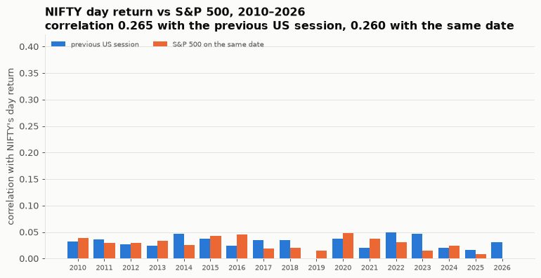

# Market terminal

[](https://github.com/Dhirajdas18/market-terminal/actions/workflows/ci.yml)

A small terminal app to open after the NSE close and review the day: today's NIFTY 50 plus a few
reference series (NIFTY Bank, India VIX, USD/INR, gold, S&P 500), end-of-day bars from Yahoo Finance kept
in a local cache. It runs only while open: no background jobs, no polling, network only at launch and on
`r`.

Screenshots use synthetic demo data (`tests/fixtures/snapshot.json`), not market data. Click one for the
full-size image. Regenerate them all with `vhs docs/screens.tape`. `uv run mt --demo tests/fixtures/snapshot.json` opens
the app on that file with no network and refresh off.

## Features

- [x] Data pipeline: Yahoo end-of-day bars since 2007 in a local parquet cache, updated incrementally;
  session date that handles NSE holidays, late bars and the 16:00 IST cut-off; snapshot schema; app
  skeleton with refresh and quit
- [x] Overview tab: NIFTY 50, NIFTY Bank, India VIX, USD/INR, gold and the S&P 500 with last close, day, week
  and year-to-date change and the position inside the 52-week range
- [x] Chart tab: NIFTY candles with 20- and 50-day averages and the traded value of the 50 stocks below;
  Movers tab: top 5 gainers, losers and unusual-volume stocks

## Usage

```bash
uv sync
uv run mt                  # first run downloads 2007 onwards (~20 s) before opening
uv run mt report data      # README chart -> out/, numbers printed
uv run mt report overview  # the S&P 500 check below
uv run mt report candles   # gaps and unusual volume below
uv run pytest
```

Later launches open on the cached data in about 0.4 s (Apple Silicon Mac, script start to first screen with Textual's
headless runner) and fetch the last week from Yahoo in the background; the header says "Updating…" until the
new data is in, or "Refresh failed: <error type>" with the cached data still on screen. Errors go to
`~/.config/market-terminal/mt.log`.

Keys: `r` refresh (runs in the background; the screen keeps the current data if it fails), `q` quit.
The header always states which day is shown, e.g. "Data for Mon 23 Nov 2026", names any stock
whose bar for a newer day has not arrived, and lists stocks with no bar for 3 or more sessions as
suspended.

## Overview tab

<a href="docs/img/screen-overview.png"></a>

Each tile uses its own series' last
valid close up to the session date. USD/INR and the S&P 500 trade on other calendars, so a tile whose
last bar is older than the session date shows it ("as of Fri 20 Nov"). Day is the change from the
previous valid close, week from the last close of the previous ISO week, year-to-date from the last
close of the previous calendar year; the bar places the last close between the lowest low and highest
high of the 365 calendar days to the session date.

## Chart tab

<a href="docs/img/screen-chart.png"></a>

<a href="docs/img/screen-chart-year.png"></a>

The candles are the most recent
sessions that fit the terminal width, one candle per column (at least 60, at most 250), redrawn on
resize; the title says how many ("last 108 sessions" in the screenshot). `y` switches to the whole year (250 sessions,
candles may be squeezed) and back. The averages are computed on the whole history and then cut, so the
first candle already has one. Green is a close above the open. The bars below are not NIFTY's own volume:
Yahoo's `^NSEI` volume has no documented meaning, so they show the 50 stocks' traded value (close ×
volume, summed, in ₹ crore). The two plots have separate y-axes and are drawn only when the tab is
first opened.

## Movers tab

<a href="docs/img/screen-movers.png"></a>

Day changes use adjusted closes with the known Yahoo errors from
`docs/data/yahoo_fixes.csv` repaired. Unusual volume is today's volume divided by the mean of the
previous 20 sessions (today left out; a day with no volume print counts as missing). A stock without
a bar on the session date is left out of all three tables.

## Findings

### 1. Yahoo has no NIFTY bar on 11 to 19 weekdays a year, and on 21 more weekdays from 2008 to 2019 it had stock bars but no index bar; of 21 one-day drops over 20%, 9 are known data errors and 12 checked out as real moves

<a href="docs/img/data_gaps.png"><picture><source media="(prefers-reduced-motion: reduce)" srcset="docs/img/data_gaps.png"></picture></a>

Weekdays from 2008 to 2025 with no `^NSEI` close on Yahoo, split by whether any NSE series in the table
(the 50 stocks, NIFTY Bank, India VIX, GOLDBEES) has a bar that day.

- **No NSE bar at all:** 11 to 19 weekdays a year, median 15. These are NSE holidays, plus any day
  Yahoo lost for every ticker.
- **Index bar missing on a trading day:** 21 weekdays in 10 of the years from 2008 to 2019; none from
  2020 to 2025. The app treats a missing NIFTY bar like any other late bar: it shows the last day every
  NSE series has and names NIFTY in the header.
- **Bad-print scan:** 21 one-day drops of more than 20% in the adjusted closes (India VIX left out).
  9 are covered by `docs/data/yahoo_fixes.csv` (unadjusted corporate actions and prices from before a
  listing). The other 12 were checked one by one and kept as real moves:
  - 6 fell on days NIFTY itself fell 5.9% to 13.0%: Kotak Mahindra Bank on 24 Oct 2008 (NIFTY
    −12.2%); Axis Bank, Bajaj Finance, Bajaj Finserv and Shriram Finance on 23 Mar 2020 (−13.0%);
    Adani Ports on 4 Jun 2024 (−5.9%).
  - 5 match same-day news reports of the fall: Adani Enterprises on 29 Jul 2011, 26 Apr 2017 and
    1–2 Feb 2023, and Infosys on 12 Apr 2013 (−21.3%, the day of its annual guidance).
  - Bajaj Finance on 8 Oct 2008 (−20.0%) closed at the day's low on 17 times the previous day's volume;
    no news report was found.

  None of the 12 has a split or bonus on Yahoo's corporate-action list, and none returned to the
  previous price the next day.

### 2. NIFTY's day return correlates 0.265 with the previous US session's S&P 500 return and 0.260 with the S&P return dated the same day (t 17.4 and 17.0)

<a href="docs/img/overview_sp500.png"><picture><source media="(prefers-reduced-motion: reduce)" srcset="docs/img/overview_sp500.png"></picture></a>

NSE sessions from 2010 to 23 Nov 2026 on which both S&P comparisons exist (4,010 days). For an NSE date the
"previous US session" is the last S&P 500 date strictly before it, so a Monday pairs with the
previous Friday. NIFTY's return is vs its own previous NSE session; a missing NIFTY bar gives no return
for that day or the next.

- **Whole period:** 0.265 (t 17.4) against the previous US session, 0.260 (t 17.0) against the same
  date; the difference is 0.005 (no significance test was run on it).
- **By year:** the previous session is higher in 8 of 17 years (2011, 2014, 2017, 2018, 2022, 2023,
  2025 and 2026, the last to 23 Nov), the same date in the other 9. Yearly values run from 0.00 to 0.40.

### 3. NIFTY opens within ±0.5% of the previous close on 78% of sessions; a stock's next-session move is 0.25 points larger after a top-decile volume day (t 20.6) and 0.07 points smaller once that day's own move is held fixed (t −3.9)

<a href="docs/img/candles_gaps.png"><picture><source media="(prefers-reduced-motion: reduce)" srcset="docs/img/candles_gaps.png"></picture></a>

<a href="docs/img/candles_volume.png"><picture><source media="(prefers-reduced-motion: reduce)" srcset="docs/img/candles_volume.png"></picture></a>

- **Gap** is a session's open divided by the last valid NIFTY close, minus 1: 4,705 sessions from
  18 Sep 2007 to 23 Nov 2026. Median absolute gap 0.23%; 53.0% of sessions are under 0.25%, 78.4% under
  0.5% and 94.1% under 1%; 63 are above 2%. 63.8% open above the previous close. Largest up: 29 Oct 2008
  (+6.4%); largest down: 23 Mar 2020 (−9.1%).
- **Unusual volume** is a stock's volume divided by the mean of its previous 20 sessions; a stock-day is
  in the top decile when its ratio ranks in the top 10% of that day's 50 stocks (ranked within the
  day, from that day's ratios only). 218,305 stock-days on 4,878 dates, 23,797 of them top decile; the
  50 are today's NIFTY members.
- **Next-session absolute return**, top decile against all other stock-days: 1.70% against 1.44%, a
  difference of +0.25 points (t 20.6, standard errors clustered by date). Split at the middle stock-day (2017): 2007 to 2017, 1.81% against 1.57% (+0.23,
  t 14.2); 2017 to 2026, 1.57% against 1.32% (+0.26, t 14.1).
- **Holding the day's own move fixed:** regressing the next-session absolute return on the top-decile
  flag and that day's absolute return gives −0.066 points on the flag (t −3.9) and 0.239 on the day's
  absolute return.
- **Bad-print scan before these numbers:** no stock moved more than 15% in a day, then more than 12% the
  other way the next day, while NIFTY moved less than 2%. Dropping the NIFTY condition finds 5 stock-days
  and each was checked: ICICI Bank on 10 Oct 2008 (NIFTY −6.7%, then +6.4%), Sun Pharma on 18 May 2009
  (NIFTY +17.7%), Apollo Hospitals on 20 Mar 2020 (NIFTY +5.8%, then −13.0%) and HDFC
  Life on 23 Mar 2020 (NIFTY −13.0%, then +2.5%) moved with the index. Shriram Finance on 17 Apr 2020
  (+17.7%, NIFTY +3.0%; −14.6% the next day) has open, high, low and close consistent with each other,
  22.9 million and 39.0 million shares traded (17.0 million two days before), and fell again to 114.7
  on 21 Apr, so it is kept as a real move. None needed a fix.
- **Sample:** the 50 are today's members applied to past years (survivorship-biased, see Design); the
  `mt report candles` output prints every number above.

## Design

- `src/mt/data.py`: tickers, Yahoo download with retries (`DownloadFailed` names any missing ticker and
  leaves the cache untouched), incremental cache update with a 7-day overlap written atomically, cache
  load with a date filter, daily returns with known Yahoo errors repaired from
  `docs/data/yahoo_fixes.csv`.
- `src/mt/session.py`: which trading day to show.
- `src/mt/overview.py`: day / week / year-to-date change and 52-week position per series.
- `src/mt/candles.py`: moving averages, gaps, traded value, movers and unusual volume.
- `src/mt/snapshot.py`: one plain dict that every screen reads; schema in [docs/snapshot.md](docs/snapshot.md).
- `src/mt/app.py`, `widgets.py`, `app.tcss`: the Textual app; colours from the chart tokens in `plots.py`.
- `src/mt/reports.py`: README findings, reproducible with `mt report <topic>`.

Price data is not committed: `data/` is a local cache. Constituents are a snapshot of NSE's NIFTY 50
list in `docs/data/nifty50.csv`; using today's members over past years is survivorship-biased.

MIT licence.
