# Market terminal

[](https://github.com/Dhirajdas18/market-terminal/actions/workflows/ci.yml)

<a href="docs/img/demo.mp4"><picture><source media="(prefers-reduced-motion: reduce)" srcset="docs/img/screen-overview.png">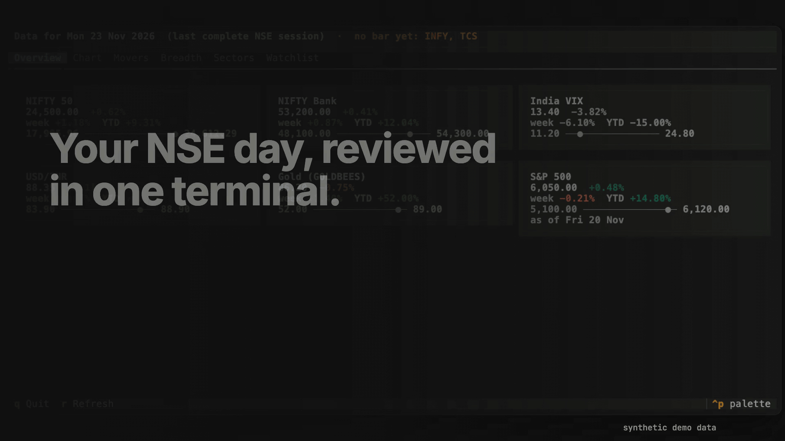</picture></a>

A small terminal app to open after the NSE close and review the day: today's NIFTY 50 plus a few
reference series (NIFTY Bank, India VIX, USD/INR, gold, S&P 500), end-of-day bars from Yahoo Finance kept
in a local cache. It runs only while open: no background jobs, no polling, network only at launch and on
`r`.

The demo and the screenshots use synthetic data (`tests/fixtures/snapshot.json`), not market data. Click the
demo for the video, a screenshot for the full-size image. Regenerate them with `vhs docs/demo.tape` and
`vhs docs/screens.tape`. `uv run mt --demo tests/fixtures/snapshot.json` opens
the app on that file with no network and refresh off.

## Features

- [x] Data pipeline: Yahoo end-of-day bars since 2007 in a local parquet cache, updated incrementally;
  session date that handles NSE holidays, late bars and the 16:00 IST cut-off; snapshot schema; app
  skeleton with refresh and quit
- [x] Overview tab: NIFTY 50, NIFTY Bank, India VIX, USD/INR, gold and the S&P 500 with last close, day, week
  and year-to-date change and the position inside the 52-week range
- [x] Chart tab: NIFTY candles with 20- and 50-day averages and the traded value of the 50 stocks below;
  Movers tab: top 5 gainers, losers and unusual-volume stocks
- [x] Breadth tab: stocks above their 50-day average, up / down / unchanged and 250-day highs and lows,
  each with the number of stocks it could be computed for, and a one-year line of the 50-day share
- [x] Sectors tab: a heatmap of the 15 sectors' average day return with the number of stocks in each, and
  the 10 stocks that moved NIFTY most in index points, from weights estimated over the previous 60 sessions
- [x] Watchlist tab and stock view: a saved list of NIFTY 50 stocks with close, day, 1-month and 1-year change,
  volatility and beta; Enter on any stock (Movers, Sectors, Watchlist) opens candles with the 20- and 50-day
  averages, beta, volatility, max drawdown and the one-day loss on ₹1,00,000 at 95%
- [x] Whole app: opens on the cache and updates in the background, keeps the cached data on screen when
  the update fails, and once a day compares `docs/data/nifty50.csv` with NSE's published NIFTY 50 list
  (a header notice names symbols added or dropped)

## Usage

```bash
uv sync
uv run mt                  # first run downloads 2007 onwards (~20 s) before opening
uv run mt report data      # README chart -> out/, numbers printed
uv run mt report overview  # the S&P 500 check below
uv run mt report candles   # gaps and unusual volume below
uv run mt report breadth   # the out-of-sample check below
uv run mt report sectors   # the tracking test below
uv run mt report stock     # the VaR check below
uv run pytest
```

Later launches open on the cached data in about 0.5 s (Apple Silicon Mac, start to first screen in a real terminal; see Running it) and fetch the last week from Yahoo in the background; the header says "Updating…" until the
new data is in, or "Refresh failed: <error type>" with the cached data still on screen. Errors go to
`~/.config/market-terminal/mt.log`.

Keys: `r` refresh (runs in the background; the screen keeps the current data if it fails), `q` quit.
`←`/`→` switch tabs; `y` on the Chart tab toggles between the width-fitted candles and the whole year; `↓` (or Tab) moves into a tab's stock table, Enter opens the highlighted stock and Escape
returns. On the Watchlist tab `a` picks a stock to add and `d` removes the highlighted one. The watchlist is
`~/.config/market-terminal/watchlist.json` (a JSON list of NIFTY 50 symbols; anything else in it is ignored).
The header always states which day is shown, e.g. "Data for Mon 23 Nov 2026", names any stock
whose bar for a newer day has not arrived, and lists stocks with no bar for 3 or more sessions as
suspended.

### Running it

Measured on an Apple Silicon Mac, `mt` started in a real pseudo-terminal (200 × 50) on the warm cache
(5,193 days, 336 columns, 10.1 MB), with `ps` sampled every 5 s for 60 s. How they were measured is in finding 7 below.

| What | Measured |
|---|---|
| Start to first screen (cached data on screen) | 0.58 s |
| First run, no cache: download from 2007 | 17.7 s, 10.1 MB parquet |
| Later launch: background update of the last 7 days | 7.2 s |
| Memory (RSS) at first screen / after the update | 206 MB / 271 MB (target under 200 MB: not met) |
| CPU while idle, 10 s to 60 s after launch | 0.0% at every sample |
| `q` to process exit | 0.32 s; `pgrep` finds nothing |

## Data and limits

- Prices are Yahoo Finance end-of-day bars: free, unofficial and sometimes wrong (finding 1 lists the
  errors found and `docs/data/yahoo_fixes.csv` the ones repaired). The app is meant for after the close;
  it has no intraday prices.
- The 50 stocks are today's NIFTY 50 applied to past years, so every historical number is
  survivorship-biased.
- The header always says which day is shown; on a holiday, with a late bar or with a suspended stock it
  shows the last complete session and names what is missing.
- The demo and the screenshots are synthetic data, not market prices. Nothing here is investment advice.

## Overview tab

<a href="docs/img/screen-overview.png">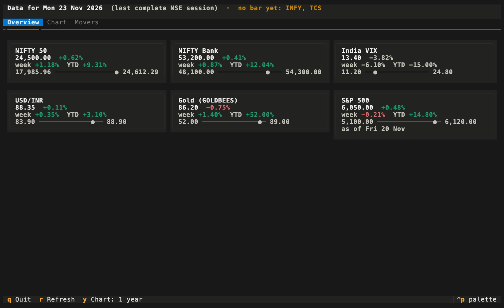</a>

Each tile uses its own series' last
valid close up to the session date. USD/INR and the S&P 500 trade on other calendars, so a tile whose
last bar is older than the session date shows it ("as of Fri 20 Nov"). Day is the change from the
previous valid close, week from the last close of the previous ISO week, year-to-date from the last
close of the previous calendar year; the bar places the last close between the lowest low and highest
high of the 365 calendar days to the session date.

## Chart tab

<a href="docs/img/screen-chart.png">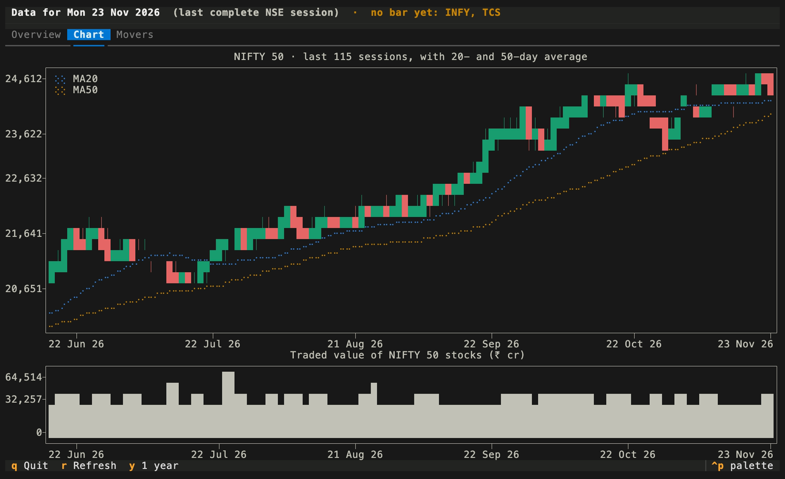</a>

<a href="docs/img/screen-chart-year.png">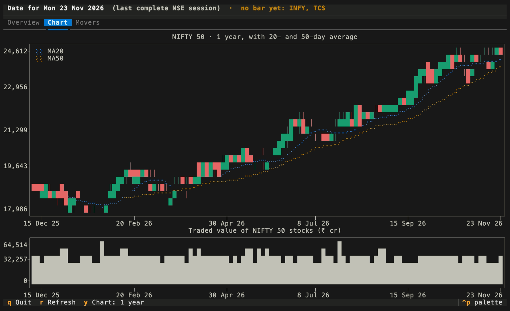</a>

The candles are the most recent
sessions that fit the terminal width, one candle per column (at least 60, at most 250), redrawn on
resize; the title says how many ("last 115 sessions" in the screenshot). `y` switches to the whole year (250 sessions,
candles may be squeezed) and back. The averages are computed on the whole history and then cut, so the
first candle already has one. Green is a close above the open. The bars below are not NIFTY's own volume:
Yahoo's `^NSEI` volume has no documented meaning, so they show the 50 stocks' traded value (close ×
volume, summed, in ₹ crore). The two plots have separate y-axes and are drawn only when the tab is
first opened.

## Movers tab

<a href="docs/img/screen-movers.png">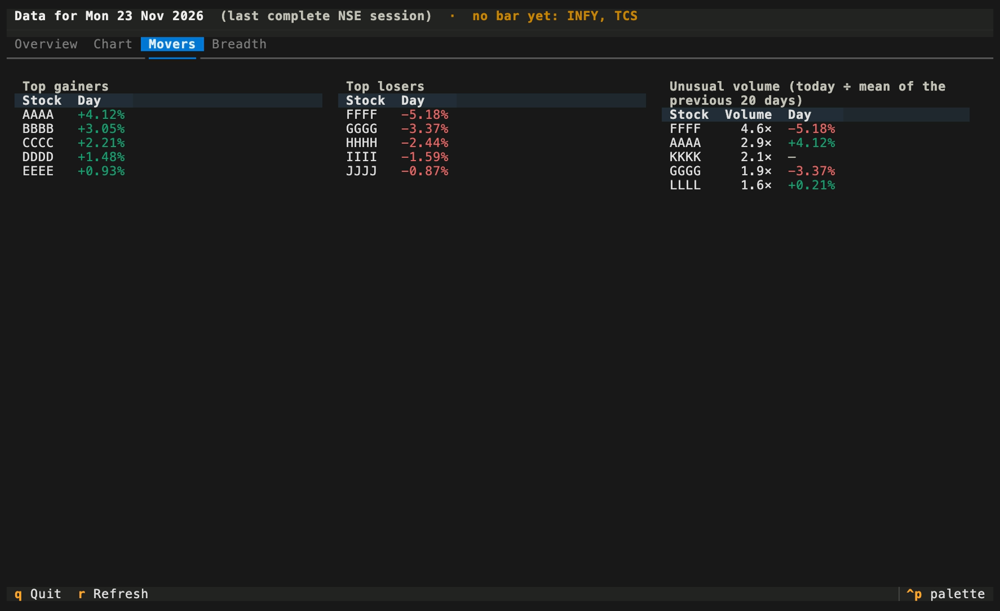</a>

Day changes use adjusted closes with the known Yahoo errors from
`docs/data/yahoo_fixes.csv` repaired. Unusual volume is today's volume divided by the mean of the
previous 20 sessions (today left out; a day with no volume print counts as missing). A stock without
a bar on the session date is left out of all three tables.

## Breadth tab

<a href="docs/img/screen-breadth.png">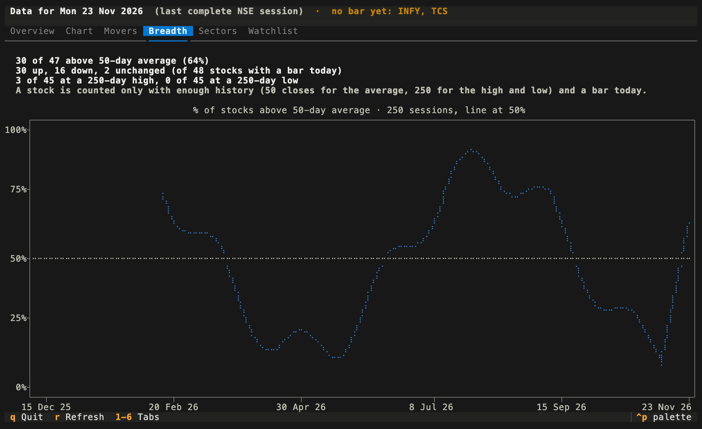</a>

Every count shows how many stocks it could be computed for. A stock enters the 50-day count once it has
50 closes and the 250-day high and low once it has 250 (a recent listing stays out of that count and its
total); a stock with no bar on the session date is left out of all of them, and so is one with a missing
close inside the window until the window is clear. The average includes the day's close, and a close
equal to the average is not above it. A 250-day high means the close is at or above the previous 249
closes. Up, down and unchanged use adjusted closes with the known Yahoo errors repaired; the
average and high/low counts use closes with the bad prints and pre-listing prices in
`docs/data/yahoo_fixes.csv` removed. Rows that are not trading days (a holiday, or a bar Yahoo gives one
ticker on a Saturday) are dropped before any window is taken. The line is drawn when the tab is first opened.

## Sectors tab

<a href="docs/img/screen-sectors.png">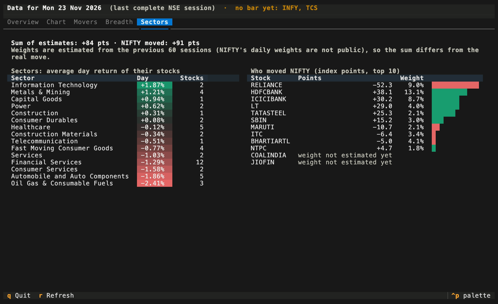</a>

The heatmap shows each sector's equal-weight mean of its stocks' day returns (a stock with no bar is left
out of the mean and of the count); the colour is grey at 0 and reaches full green or red at ±2%. NIFTY is
a price index, so returns here come from `close`, not `adj_close`, with the unadjusted corporate actions in
`docs/data/yahoo_fixes.csv` set to a zero return. NSE's daily weights are not free, so each stock's weight
is estimated: the non-negative weights (`scipy.optimize.nnls`) that best reproduce NIFTY's daily returns
from the stocks' over the 60 sessions before the day (the day itself is not in the fit), scaled to sum to 1.
A stock's points are weight × its day return × NIFTY's previous close. A stock without 60 valid returns
in that span has no weight and is listed as "weight not estimated yet". The header compares the sum of all
estimates with NIFTY's actual move; finding 5 measures how far apart the two are.

The screenshot is synthetic demo data: its 10 listed stocks add +68.1 points, the other 38 stocks with a
weight add +16.2, and the two make the +84 shown.

## Watchlist tab and stock view

<a href="docs/img/screen-watchlist.png">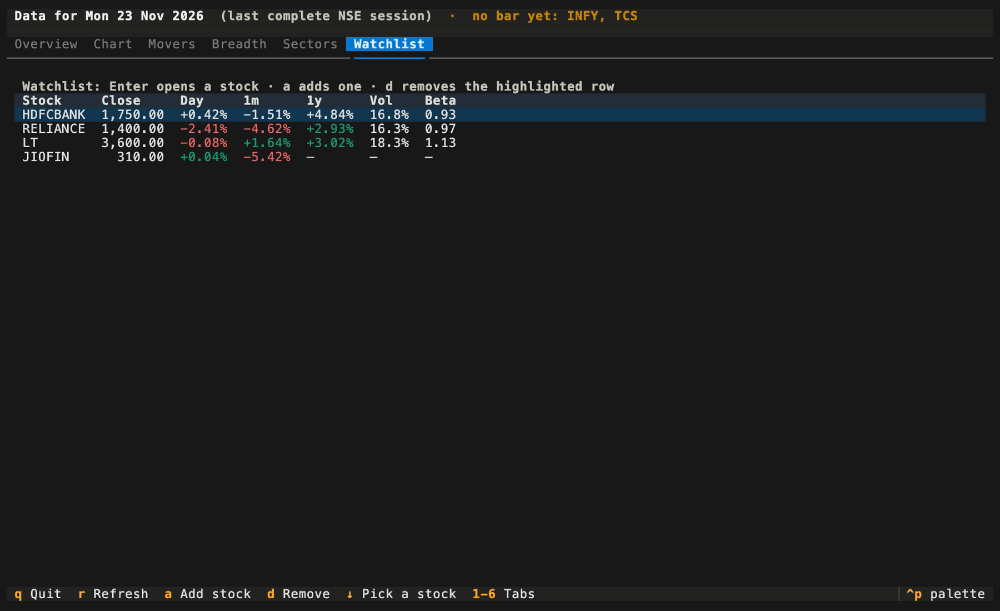</a>

<a href="docs/img/screen-stock.png">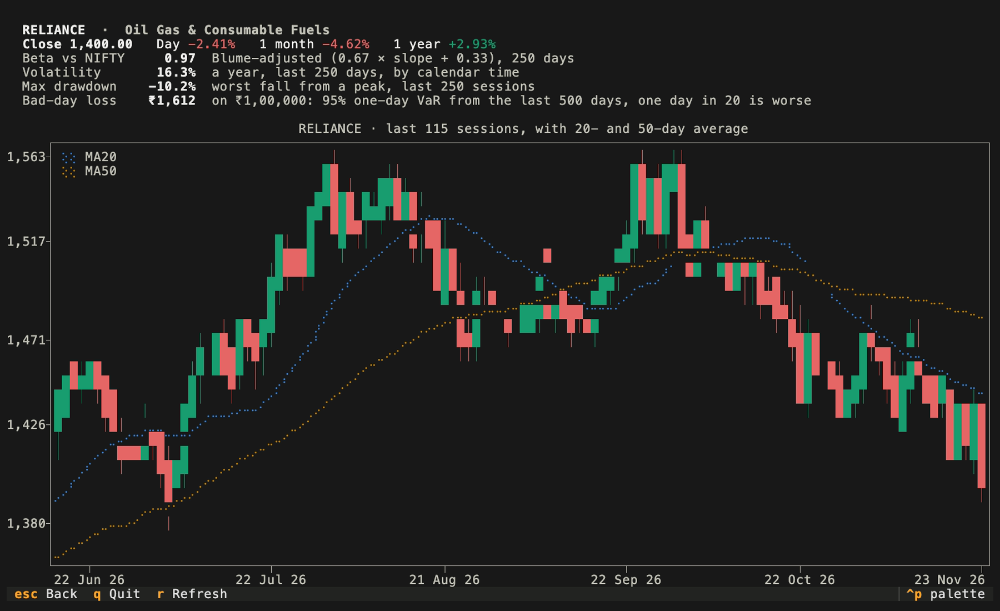</a>

Both screenshots are synthetic demo data (the demo watchlist lives in memory; `mt --demo` never touches
`~/.config/market-terminal/watchlist.json`). Day, 1-month (21 sessions) and 1-year (250 sessions) changes
compound the daily returns of adjusted closes, with the known Yahoo errors repaired. Beta is 0.67 × the slope of the
stock's daily returns on NIFTY's plus 0.33, over the last 250 returns both have. Volatility is the standard
deviation of the last 250 returns scaled by the number of returns per calendar year over that span, not by
252. Max drawdown is the worst fall from a peak in the last 250 closes. The bad-day loss is the 5th percentile
of the last 500 daily returns, as rupees on ₹1,00,000: a historical one-day 95% value at risk. A stock without
enough history for a measure (250 returns; 250 of the last 500 for the loss) shows a dash and "not enough
history" (JIOFIN in the screenshot). The stock view is built when a row is opened, not at launch; the snapshot
holds each stock's last 250 sessions of candles (about 0.8 MB of JSON for the 50, 0.1 s to build).

## Findings

### 1. Yahoo has no NIFTY bar on 11 to 19 weekdays a year, and on 21 more weekdays from 2008 to 2019 it had stock bars but no index bar; of 21 one-day drops over 20%, 9 are known data errors and 12 checked out as real moves

<a href="docs/img/data_gaps.png"><picture><source media="(prefers-reduced-motion: reduce)" srcset="docs/img/data_gaps.png">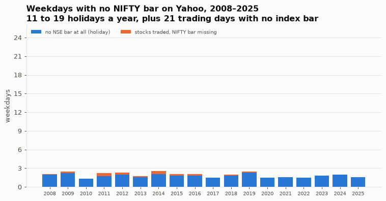</picture></a>

Weekdays from 2008 to 2025 with no `^NSEI` close on Yahoo, split by whether any NSE series in the table
(the 50 stocks, NIFTY Bank, India VIX, GOLDBEES) has a bar that day.

- **No NSE bar at all:** 11 to 19 weekdays a year, median 15. These are NSE holidays, plus any day
  Yahoo lost for every ticker.
- **Index bar missing on a trading day:** 21 weekdays in 10 of the years from 2008 to 2019; none from
  2020 to 2025. The app treats a missing NIFTY bar like any other late bar: it shows the last day every
  NSE series has and names NIFTY in the header.
- **Bad-print scan:** 21 one-day drops of more than 20% in the adjusted closes (India VIX left out).
  9 are covered by `docs/data/yahoo_fixes.csv` (unadjusted corporate actions and prices from before a
  listing). The other 12 were checked one by one and kept as real moves:
  - 6 fell on days NIFTY itself fell 5.9% to 13.0%: Kotak Mahindra Bank on 24 Oct 2008 (NIFTY
    −12.2%); Axis Bank, Bajaj Finance, Bajaj Finserv and Shriram Finance on 23 Mar 2020 (−13.0%);
    Adani Ports on 4 Jun 2024 (−5.9%).
  - 5 match same-day news reports of the fall: Adani Enterprises on 29 Jul 2011, 26 Apr 2017 and
    1–2 Feb 2023, and Infosys on 12 Apr 2013 (−21.3%, the day of its annual guidance).
  - Bajaj Finance on 8 Oct 2008 (−20.0%) closed at the day's low on 17 times the previous day's volume;
    no news report was found.

  None of the 12 has a split or bonus on Yahoo's corporate-action list, and none returned to the
  previous price the next day.

### 2. NIFTY's day return correlates 0.265 with the previous US session's S&P 500 return and 0.260 with the S&P return dated the same day (t 17.4 and 17.0)

<a href="docs/img/overview_sp500.png"><picture><source media="(prefers-reduced-motion: reduce)" srcset="docs/img/overview_sp500.png"></picture></a>

NSE sessions from 2010 to 23 Nov 2026 on which both S&P comparisons exist (4,010 days). For an NSE date the
"previous US session" is the last S&P 500 date strictly before it, so a Monday pairs with the
previous Friday. NIFTY's return is vs its own previous NSE session; a missing NIFTY bar gives no return
for that day or the next.

- **Whole period:** 0.265 (t 17.4) against the previous US session, 0.260 (t 17.0) against the same
  date; the difference is 0.005 (no significance test was run on it).
- **By year:** the previous session is higher in 8 of 17 years (2011, 2014, 2017, 2018, 2022, 2023,
  2025 and 2026, the last to 23 Nov), the same date in the other 9. Yearly values run from 0.00 to 0.40.

### 3. NIFTY opens within ±0.5% of the previous close on 78% of sessions; a stock's next-session move is 0.25 points larger after a top-decile volume day (t 20.6) and 0.07 points smaller once that day's own move is held fixed (t −3.9)

<a href="docs/img/candles_gaps.png"><picture><source media="(prefers-reduced-motion: reduce)" srcset="docs/img/candles_gaps.png">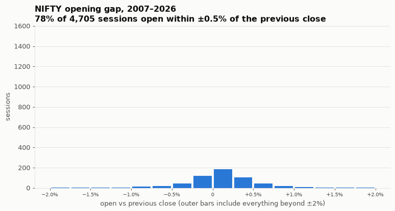</picture></a>

<a href="docs/img/candles_volume.png"><picture><source media="(prefers-reduced-motion: reduce)" srcset="docs/img/candles_volume.png">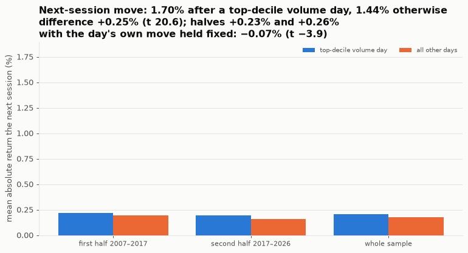</picture></a>

- **Gap** is a session's open divided by the last valid NIFTY close, minus 1: 4,705 sessions from
  18 Sep 2007 to 23 Nov 2026. Median absolute gap 0.23%; 53.0% of sessions are under 0.25%, 78.4% under
  0.5% and 94.1% under 1%; 63 are above 2%. 63.8% open above the previous close. Largest up: 29 Oct 2008
  (+6.4%); largest down: 23 Mar 2020 (−9.1%).
- **Unusual volume** is a stock's volume divided by the mean of its previous 20 sessions; a stock-day is
  in the top decile when its ratio ranks in the top 10% of that day's 50 stocks (ranked within the
  day, from that day's ratios only). 218,305 stock-days on 4,878 dates, 23,797 of them top decile; the
  50 are today's NIFTY members.
- **Next-session absolute return**, top decile against all other stock-days: 1.70% against 1.44%, a
  difference of +0.25 points (t 20.6, standard errors clustered by date). Split at the middle stock-day (2017): 2007 to 2017, 1.81% against 1.57% (+0.23,
  t 14.2); 2017 to 2026, 1.57% against 1.32% (+0.26, t 14.1).
- **Holding the day's own move fixed:** regressing the next-session absolute return on the top-decile
  flag and that day's absolute return gives −0.066 points on the flag (t −3.9) and 0.239 on the day's
  absolute return.
- **Bad-print scan before these numbers:** no stock moved more than 15% in a day, then more than 12% the
  other way the next day, while NIFTY moved less than 2%. Dropping the NIFTY condition finds 5 stock-days
  and each was checked: ICICI Bank on 10 Oct 2008 (NIFTY −6.7%, then +6.4%), Sun Pharma on 18 May 2009
  (NIFTY +17.7%), Apollo Hospitals on 20 Mar 2020 (NIFTY +5.8%, then −13.0%) and HDFC
  Life on 23 Mar 2020 (NIFTY −13.0%, then +2.5%) moved with the index. Shriram Finance on 17 Apr 2020
  (+17.7%, NIFTY +3.0%; −14.6% the next day) has open, high, low and close consistent with each other,
  22.9 million and 39.0 million shares traded (17.0 million two days before), and fell again to 114.7
  on 21 Apr, so it is kept as a real move. None needed a fix.
- **Sample:** the 50 are today's members applied to past years (survivorship-biased, see Design); the
  `mt report candles` output prints every number above.

### 4. Scored on 2017 to 2026, the share of stocks above their 50-day average separates NIFTY's next-20-bar return by +0.12% between high and low days (t 0.2); NIFTY's own position against its 50-day average separates it by +0.43% (t 0.7)

<a href="docs/img/breadth_history.png"><picture><source media="(prefers-reduced-motion: reduce)" srcset="docs/img/breadth_history.png">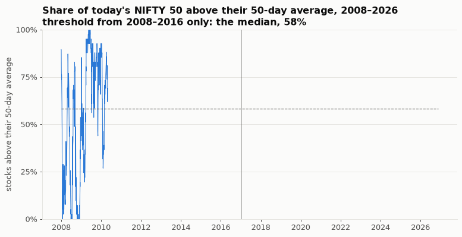</picture></a>

<a href="docs/img/breadth_returns.png"><picture><source media="(prefers-reduced-motion: reduce)" srcset="docs/img/breadth_returns.png">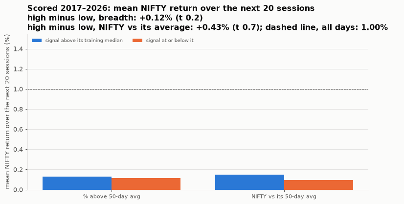</picture></a>

- **Question:** does the share of stocks above their 50-day average add anything to NIFTY's own
  position against its 50-day average for NIFTY's return over the next 20 NIFTY bars? Each signal's
  threshold is its median over 2008 to 2016 (2,195 sessions): 58.1% of stocks for breadth, NIFTY 1.07%
  above its average for the baseline. Only sessions from 2 Jan 2017 are scored; the 2008 to 2016
  sessions fix the thresholds and nothing else.
- **Scored sample:** 2,419 sessions from 2 Jan 2017 to 23 Oct 2026 (later sessions do not have 20
  NIFTY bars ahead yet). Across all of them NIFTY rose over the next 20 NIFTY bars 63.5% of the time, a mean
  of +1.00%. Standard errors are Newey-West with 19 lags (20-bar returns overlap by 19 bars).
- **Breadth above its training median:** 1,297 sessions, up 65.0%, mean +1.06% (t 3.2). At or below:
  1,122 sessions, up 61.7%, mean +0.94% (t 1.7). Difference +0.12% (t 0.2).
- **NIFTY above its training-median distance from its 50-day average:** 1,305 sessions, up 67.7%, mean
  +1.20% (t 3.9). At or below: 1,114 sessions, up 58.5%, mean +0.77% (t 1.3). Difference +0.43%
  (t 0.7). With the cut-off at its own average (zero) instead: 1,607 and 812 sessions, +1.11% and
  +0.78%, difference +0.33% (t 0.5).
- **Both flags in one regression:** breadth −0.47% (t −0.8), NIFTY against its average +0.79% (t 1.2).
  The two flags give the same answer on 88% of sessions.
- **Sample:** the 50 are today's NIFTY members applied to past years, so stocks that left the index
  are missing: survivorship-biased; read the numbers as an upper bound.
- **Stock count:** the 50-day share is computed over 38 stocks on 2 Jan 2008, growing to 50.
- `mt report breadth` prints every number above.

### 5. Out of sample, weights from the previous 60 sessions put the sum of stock contributions within 10 NIFTY points of the day's move on 56.8% of 4,127 NIFTY bars from 2010 (equal weights: 26.3%); the median error is 14.7% of the day's move

<a href="docs/img/sectors_tracking.png"><picture><source media="(prefers-reduced-motion: reduce)" srcset="docs/img/sectors_tracking.png">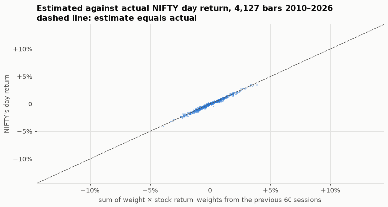</picture></a>

<a href="docs/img/sectors_error_by_year.png"><picture><source media="(prefers-reduced-motion: reduce)" srcset="docs/img/sectors_error_by_year.png">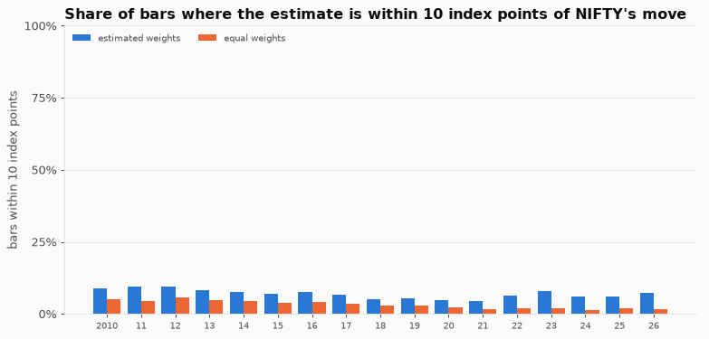</picture></a>

- **Test:** every NIFTY bar from 4 Jan 2010 to 23 Nov 2026 that has a return (4,127) is scored with
  weights fitted only on the 60 sessions before it. Error is the sum of the stocks' contributions minus
  NIFTY's actual points. A stock without 60 valid returns before the day has no weight and adds nothing:
  41 to 50 stocks (median 47) have one on a scored bar.
- **Estimated weights:** absolute error median 8.4 points, 90th percentile 24.6; within 10 points on
  56.8% of bars. Error as a share of NIFTY's absolute move: median 14.7%, 13.4% with all days summed.
- **Equal weights (the plain baseline):** median 21.3 points, 90th percentile 71.1, within 10 points on
  26.3%; median 36.8% of the move, 35.5% with all days summed.
- **By period:** within 10 points on 68.1% of the 1,693 bars of 2010 to 2016 and 49.0% of the 2,434
  from 2017 on; by year from 37.9% (2021) to 78.6% (2011). NIFTY's mean previous close was 5,457 in 2010
  and 24,139 in 2026, so 10 points is a smaller share of the index later; the median error as a share of
  the day's move was 17.3% in 2010 and 6.4% in 2026.
- **NSE factsheet:** [the NIFTY 50 factsheet](https://www.niftyindices.com/Factsheet/ind_nifty50.pdf) dated 30 Oct 2026
  (fetched 24 Nov 2026; not stored here) lists 10 weights. Weights estimated from the 60 sessions ending
  that day put 8 of the same 10 stocks in the top 10 (M&M and TCS in place of Kotak Mahindra Bank and
  Bajaj Finance). Over NSE's 10 stocks the mean absolute difference is 0.41 percentage points, the largest
  1.06 (Kotak Mahindra Bank: 2.13% estimated, 3.19% listed), and the 10 estimates total 51.3% against 53.04%.
- **No regularisation:** the plain non-negative fit is used, with 60 observations for up to 50 weights.
- **Sample:** the 50 are today's members applied to past years (survivorship-biased);
  `mt report sectors` prints every number above.

### 6. Scored out of sample from 2012, 5.04% of 169,482 stock-days lost more than the 95% one-day VaR from the previous 500 returns (target 5%); by year the share runs from 1.9% (2023) to 8.2% (2020)

<a href="docs/img/stock_var_breaches.png"><picture><source media="(prefers-reduced-motion: reduce)" srcset="docs/img/stock_var_breaches.png">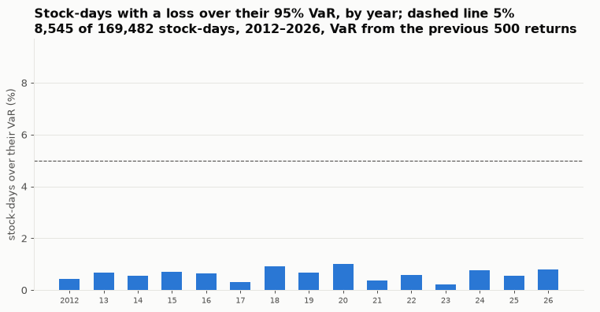</picture></a>

- **Test:** for each of the 50 stocks and each session from 2 Jan 2012 to 23 Nov 2026, the VaR is the 5th
  percentile of the previous 500 returns (at least 250; the day itself is never in its window); a breach is
  a return below minus that VaR. 169,482 stock-days on 3,673 dates, 43 to 50 stocks a date (median 47).
- **Breach rate:** 8,545 breaches, 5.04%. Binomial test against 5%: p 0.43, 95% interval 4.94% to 5.15%;
  Kupiec's test: likelihood ratio 0.6, p 0.43. Both treat the 50 stocks of a date as independent.
- **By date:** the share of stocks breaching on a date averages 5.04%; its t against 5% over the 3,673
  dates is 0.25 (one number per date, so same-day clustering across stocks does not count as extra evidence).
- **Clustering:** the five dates with the most breaches are 12 Mar 2020 (46 of 47 stocks), 23 Mar 2020
  (46 of 47), 16 Mar 2020 (43 of 47), 24 Feb 2022 (42 of 48) and 24 Aug 2015 (40 of 43); the 20 dates with
  the most breaches hold 8.2% of all breaches.
- **By year:** 2012 3.6%, 2013 5.6%, 2014 4.5%, 2015 5.8%, 2016 5.2%, 2017 2.6%, 2018 7.5%, 2019 5.5%,
  2020 8.2%, 2021 3.0%, 2022 4.7%, 2023 1.9%, 2024 6.3%, 2025 4.7%, 2026 6.5% (to 23 Nov).
- **By stock:** own breach rates run from 3.1% (Eternal) to 5.9% (BSE), median 5.0%; 1 of 50 stocks has a
  Kupiec p below 0.05 (Eternal), against about 2.5 expected if all were on target.
- **Bad-print scan before these numbers:** the 10 biggest breach losses are Adani Enterprises on 1 Feb
  2023 (−28.2%), 2 Feb 2023 (−26.7%), 21 Nov 2024 (−22.6%) and 26 Apr 2017 (−20.9%); Axis Bank (−27.9%),
  Bajaj Finserv (−25.9%), Bajaj Finance (−23.2%) and Shriram Finance (−22.2%) on 23 Mar 2020 (NIFTY −13.0%);
  Infosys on 12 Apr 2013 (−21.3%); and Adani Ports on 4 Jun 2024 (−21.1%, NIFTY −5.9%). Nine are among the 12
  moves checked in finding 1. The tenth, Adani Enterprises on 21 Nov 2024, has no Yahoo bar for 19 Nov, and its
  −22.6% return spans two sessions; [Fortune](https://fortune.com/asia/2024/11/21/gautam-adani-group-shares-plunge-us-indictment-bribery/)
  and [Bloomberg](https://www.bloomberg.com/news/articles/2024-11-21/adani-bonds-tumble-after-founder-charged-by-us-authorities)
  report the fall on 21 Nov 2024. None is in `docs/data/yahoo_fixes.csv` and none rebounded by half the loss
  the next day, so none was changed.
- **Sample:** the 50 are today's members applied to past years (survivorship-biased);
  `mt report stock` prints every number above.

### 7. Launch to first screen takes 0.58 s on the cached data and 17.7 s on the first run; the app uses 206 MB at open and 271 MB after the update (above the 200 MB target), and no process is left 0.32 s after `q`

Measured on the Apple Silicon Mac above, in a real pseudo-terminal (200 × 50), on the real warm cache (not the
demo data), by a script that started `mt`, timed the first "Data for" text, ran `ps -o rss,%cpu` every 5 s for
60 s, sent `q` and then ran `pgrep`. A first measurement with the old update code gave 205 MB and 308 MB; the
update now reads only the last date and the older rows through Arrow and returns just the three-year tail.

- **First screen:** 0.58 s from start to the header line. The first run, with no cache, downloads 2007
  onwards in 17.7 s (a 10.1 MB parquet file); the app prints one line to stderr before it starts.
- **Update:** the background update of the last 7 days finished within 10 s (7.2 s when timed alone). CPU
  was 85.7% in the first second and 7.6% at 5 s, then 0.0% at each of the 11 samples from 10 s to 60 s.
- **Memory:** 206 MB at the first screen, 228 MB at 5 s and 271 MB from 10 s to the end; the target of
  under 200 MB is missed at all three points. Where the first screen's memory goes, measured one step at a
  time: Python 17 MB, pandas and numpy +74 MB, Textual and the app +19 MB, pyarrow's parquet engine starting
  on the first read +48 MB (the three-year table itself is 2 MB), scipy's optimiser +33 MB, the snapshot +10
  MB. The update adds yfinance (+15 MB) and the download frames, about 65 MB in all.
- **After `q`:** the process exited after 0.32 s and `pgrep` found no `mt` process. Files written: the price
  cache in `data/`, and in `~/.config/market-terminal/` (a 0o700 folder) the log, the watchlist, the daily
  membership stamp and yfinance's cookie and timezone databases in `yfinance/`.
- **Sample:** one machine, one run of 60 s; the numbers will differ on another Mac or with a different cache size.

## Design

- `src/mt/data.py`: tickers, Yahoo download with retries (`DownloadFailed` names any missing ticker and
  leaves the cache untouched), incremental cache update with a 7-day overlap written atomically, cache
  load with a date filter, daily returns with known Yahoo errors repaired from
  `docs/data/yahoo_fixes.csv`.
- `src/mt/session.py`: which trading day to show, and which rows of the table are NSE sessions at all.
- `src/mt/overview.py`: day / week / year-to-date change and 52-week position per series.
- `src/mt/candles.py`: moving averages, gaps, traded value, movers and unusual volume.
- `src/mt/breadth.py`: stocks above their average, up / down / unchanged, highs and lows with their
  denominators, the 50-day share per session, and the out-of-sample check.
- `src/mt/sectors.py`: sector returns, the non-negative weight estimate, contributions in index points
  and the rolling out-of-sample tracking test.
- `src/mt/stock.py`: Blume beta, calendar-time volatility, drawdown, historical VaR, the per-stock row and
  candles in the snapshot, and the rolling VaR breach test.
- `src/mt/membership.py`: the once-a-day comparison with NSE's NIFTY 50 list (HTTPS, 15 s timeout, 1 MB cap,
  validated columns and symbols), run in the update thread.
- `src/mt/watchlist.py`: the watchlist file: validated on load, atomic and owner-only on save.
- `src/mt/snapshot.py`: one plain dict that every screen reads; schema in [docs/snapshot.md](docs/snapshot.md).
- `src/mt/app.py`, `widgets.py`, `app.tcss`: the Textual app; colours from the chart tokens in `plots.py`.
- `src/mt/reports.py`: README findings, reproducible with `mt report <topic>`.

Price data is not committed: `data/` is a local cache. Constituents are a snapshot of NSE's NIFTY 50
list in `docs/data/nifty50.csv`; using today's members over past years is survivorship-biased.

MIT licence.
